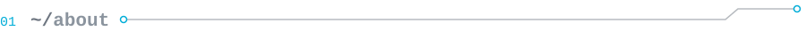

<picture>
  <source media="(max-width: 600px)" srcset="assets/header-mobile.svg">
  
</picture>

<picture>
  <source media="(max-width: 600px)" srcset="assets/section-about-mobile.svg">
  
</picture>

I'm working my way toward a career as a backend engineer. I like the parts of software most people never see: APIs, services, and the tools that keep everything running. My goal is to build systems that are simple, reliable, and fast.

Most of my time goes into Go. I'm getting better at writing clean, idiomatic, well-tested code and learning how real production systems are put together. Go, for me, is the perfect level of providing access to high-level abstractions, while also providing access to low-level control.

<picture>
  <source media="(max-width: 600px)" srcset="assets/section-toolbox-mobile.svg">
  
</picture>

**`main`**&nbsp;&nbsp;

**`secondary`**&nbsp;&nbsp;   

**`dev-env`**&nbsp;&nbsp;   

**`llm`**&nbsp;&nbsp;

I'm a Unix person, so I use a combination of Linux and MacOS. I run Arch (btw), live in the terminal, and Neovim is the basis of my dev environment. Claude is my LLM of choice currently, but would love to eventually host a local model like Qwen.

<picture>
  <source media="(max-width: 600px)" srcset="assets/section-always-learning-mobile.svg">
  
</picture>

In my spare time I'm usually self-hosting something on my home server or tinkering with hardware. Running my own stuff and taking things apart is the best way I've found to learn how systems actually work.

<picture>
  <source media="(max-width: 600px)" srcset="assets/section-currently-building-mobile.svg">
  
</picture>

- [**inventory-events-service**](https://github.com/jgarner9/inventory-events-service): An event-driven Go microservice backed by RabbitMQ and PostgreSQL
- [**godo**](https://github.com/jgarner9/godo): A minimal todo manager for the terminal, written in Go
- [**pretty-jsoner**](https://github.com/jgarner9/pretty-jsoner): A small Go CLI that pretty-prints JSON straight from your clipboard
- [**vimzer**](https://github.com/jgarner9/vimzer): Personal tool for Vim-style keyboard navigation for Chrome

<picture>
  <source media="(max-width: 600px)" srcset="assets/section-say-hi-mobile.svg">
  
</picture>

